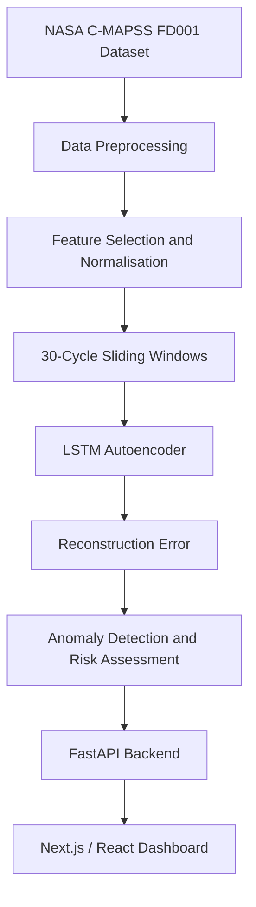

# AI-Based Predictive Maintenance System for Aerospace Engines

An end-to-end machine learning application for aerospace engine health assessment and anomaly detection using turbofan sensor data. The system combines an LSTM Autoencoder with a FastAPI backend and a Next.js dashboard to identify deviations from learned engine operating patterns.

## Table of Contents

- [Project Overview](#project-overview)
- [Objectives](#objectives)
- [System Architecture](#system-architecture)
- [Dataset and Preprocessing](#dataset-and-preprocessing)
- [Machine Learning Methodology](#machine-learning-methodology)
- [Model Configuration and Results](#model-configuration-and-results)
- [Technology Stack](#technology-stack)
- [Installation and Setup](#installation-and-setup)
- [API and Dashboard](#api-and-dashboard)
- [Limitations](#limitations)
- [Future Scope](#future-scope)
- [Author](#author)

## Project Overview

Aerospace engines operate under demanding conditions, making early identification of abnormal behaviour important for maintenance planning and operational reliability. Traditional maintenance schedules may not always capture changes in engine condition as they develop.

This project explores a data-driven approach to engine health monitoring using deep learning and multivariate time-series analysis.

The system uses an **LSTM Autoencoder** trained on comparatively healthy engine sensor sequences from the NASA C-MAPSS FD001 dataset. During inference, the model reconstructs incoming sensor sequences and calculates reconstruction error. Deviations from learned operating patterns are used as signals for anomaly detection and health assessment.

The machine learning pipeline is integrated with a FastAPI backend and a Next.js/React frontend that presents the resulting indicators through a web-based dashboard.

## Objectives

- Apply deep learning to aerospace engine sensor time-series data.
- Learn temporal patterns associated with comparatively healthy engine operation.
- Detect unusual sensor behaviour using reconstruction error.
- Develop a risk-classification layer for interpreting model outputs.
- Integrate machine learning inference with a web application.
- Demonstrate an end-to-end predictive maintenance workflow.

## System Architecture

The application consists of three main components: the data processing and machine learning pipeline, the backend inference service, and the frontend dashboard.



### Component Responsibilities

**Machine Learning Pipeline**
- Processes sensor measurements and creates sequential inputs.
- Trains the LSTM Autoencoder.
- Calculates reconstruction errors for incoming sequences.
- Generates model-derived anomaly and health indicators.

**Backend**
- Exposes prediction functionality through a REST API.
- Receives and processes uploaded CSV files.
- Loads the trained model and returns structured prediction results.

**Frontend**
- Provides a web interface for submitting sensor data.
- Displays engine health indicators, trends, and risk classifications.
- Presents model outputs in a format suitable for inspection.

## Dataset and Preprocessing

**Dataset:** NASA Commercial Modular Aero-Propulsion System Simulation (C-MAPSS)  
**Subset:** FD001

The dataset contains simulated turbofan engine run-to-failure trajectories and sensor measurements collected over successive operating cycles.

### Preprocessing Pipeline

1. Assign column names to the raw dataset.
2. Separate engine identifiers and cycle information from sensor features.
3. Remove zero-variance sensor channels.
4. Apply Min-Max normalisation.
5. Generate time-series sequences using a sliding window of 30 operational cycles.
6. Select comparatively healthy sequences for model training.

The resulting sequences preserve the temporal ordering of sensor measurements, allowing the model to learn patterns across successive operating cycles.

## Machine Learning Methodology

### LSTM Autoencoder

An LSTM Autoencoder is used to learn the temporal characteristics of engine sensor data. Its encoder compresses an input sequence into a latent representation, and its decoder reconstructs the original sequence.

The reconstruction error measures the difference between the original sensor readings and the model's reconstructed output. An unusually high error can indicate behaviour that differs from the patterns learned during training.

### Model Workflow

1. **Input:** A sequence of 30 operating cycles.
2. **Encoding:** An LSTM encoder learns temporal features from the sensor measurements.
3. **Compression:** A latent layer represents the learned sequence information.
4. **Reconstruction:** An LSTM decoder attempts to reproduce the original sequence.
5. **Error calculation:** Mean Squared Error quantifies reconstruction differences.
6. **Anomaly assessment:** The error is evaluated against the configured detection threshold.
7. **Risk classification:** The system maps model outputs to configured risk categories.
8. **Visualisation:** The results are returned to the dashboard for presentation.

### Risk Classification

The application supports four risk categories:

| Category | Description |
|---|---|
| LOW | Lower assessed risk under the configured classification logic |
| MEDIUM | Intermediate model-derived risk assessment |
| HIGH | Elevated assessment requiring further interpretation |
| CRITICAL | Highest category defined by the configured classification logic |

These categories are application-level indicators. They are not certified aircraft maintenance recommendations and should not be used independently to determine an engine's airworthiness.

## Model Configuration and Results

The documented experiment used the following configuration:

| Parameter | Value |
|---|---|
| Model architecture | LSTM Autoencoder |
| Input sequence length | 30 cycles |
| Encoder hidden dimension | 64 |
| Latent dimension | 32 |
| Training epochs | 20 |
| Batch size | 64 |
| Optimiser | Adam |
| Learning rate | 0.001 |
| Loss function | Mean Squared Error |
| Training loss | Approximately 0.008 |
| Validation loss | Approximately 0.008 |
| Anomaly threshold | 0.012 |

The reported training and validation losses describe the model's reconstruction performance on the corresponding datasets. The anomaly threshold was empirically selected for this experimental configuration.

Reconstruction loss alone does not establish the accuracy of anomaly detection. A more complete evaluation should include test-set metrics such as precision, recall, F1-score, confusion matrix, and false-positive rate, where reliable ground-truth labels are available.

**Scope clarification:** The implemented model focuses on anomaly detection and engine health assessment. It does not independently perform direct Remaining Useful Life (RUL) regression.

## Technology Stack

| Component | Technology |
|---|---|
| Programming language | Python |
| Deep learning framework | PyTorch |
| Model architecture | LSTM Autoencoder |
| Data processing | Pandas, NumPy |
| Data preprocessing | Scikit-learn |
| Backend framework | FastAPI |
| ASGI server | Uvicorn |
| Frontend framework | Next.js |
| UI library | React |
| Styling | Tailwind CSS |
| Input data format | CSV |
| API response format | JSON |
| Dataset | NASA C-MAPSS FD001 |

## Installation and Setup

### Prerequisites

- Python 3.9 or later
- Node.js 18 or later
- npm
- Git
- The trained model checkpoint and required preprocessing assets

The commands below assume that the repository contains separate `backend` and `frontend` directories.

### 1. Clone the Repository

```bash
git clone <YOUR_REPOSITORY_URL>
cd <YOUR_REPOSITORY_FOLDER>
```

Replace the placeholders with the actual repository URL and folder name.

### 2. Configure the Backend

```bash
cd backend
python -m venv venv
```

Activate the virtual environment.

**Windows PowerShell**

```powershell
.\venv\Scripts\Activate.ps1
```

**macOS or Linux**

```bash
source venv/bin/activate
```

Install the required packages:

```bash
pip install fastapi uvicorn pandas numpy torch scikit-learn
```

Ensure that the trained model checkpoint and any required preprocessing assets are present at the paths expected by the backend.

Start the backend server:

```bash
uvicorn main:app --reload --port 8000
```

### 3. Configure the Frontend

Open a separate terminal and navigate to the frontend directory:

```bash
cd frontend
npm install
npm run dev
```

Configure the backend API URL in the frontend environment file if required. Use the environment-variable name expected by the existing application code.

The frontend typically runs at:

`http://localhost:3000`

The backend runs on port `8000` with the command shown above.

**Configuration note:** Verify the actual directory structure, model checkpoint path, dependency requirements, and API configuration before running these commands. The setup instructions may need adjustment to match the repository.

## API and Dashboard

### Prediction API

The documented backend includes a CSV prediction endpoint:

```http
POST /predict-file
```

The endpoint accepts sensor data in the format expected by the model's preprocessing pipeline and returns a structured JSON response.

Example response structure:

```json
{
  "error": 0.007832,
  "health_score": 0.348,
  "anomaly": false,
  "risk": "MEDIUM"
}
```

The values above are illustrative and do not represent a guaranteed prediction. Actual outputs depend on the input data, model, and configured classification logic.

### Dashboard Capabilities

The frontend provides a visual interface for interpreting model outputs, including:

- Engine health gauges and indicators.
- Sensor-derived trend visualisations.
- Fault-related indicators.
- Risk classification.
- Additional context for interpreting assessment results.

The dashboard is designed to make model outputs easier to inspect. It is not a substitute for certified diagnostic systems or qualified aerospace maintenance procedures.

## Limitations

- The documented experiment focuses on the FD001 dataset subset.
- The anomaly threshold is specific to the current experimental configuration.
- Anomaly detection identifies unusual patterns but does not independently establish their physical cause.
- The current application processes uploaded CSV files rather than live aircraft telemetry.
- The model does not independently predict Remaining Useful Life.
- Detection performance requires evaluation on suitable held-out test data.
- The system is an academic prototype, not a certified aerospace safety or maintenance system.

## Future Scope

- Evaluate the approach on additional C-MAPSS subsets.
- Conduct comprehensive test-set evaluation and false-positive analysis.
- Compare the LSTM Autoencoder against alternative anomaly-detection methods.
- Develop a dedicated Remaining Useful Life prediction model.
- Add sensor-level explainability to help interpret detected anomalies.
- Investigate live telemetry integration.
- Explore cloud deployment, monitoring, and stronger operational controls.

## Author

**Tanmay Kunjir**  
B.Sc. Data Science Honours

**Project:** AI-Based Predictive Maintenance System for Aerospace Engines

